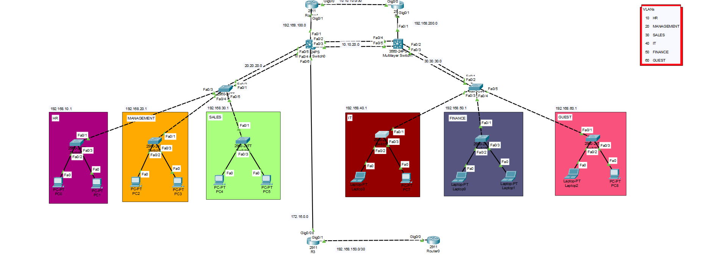

# CCNA Campus Network Design and Implementation

## Project Overview
Designed and implemented a multi-layer campus network using Cisco Packet Tracer.

## Technologies Used
- Cisco Packet Tracer
- VLAN and DHCP
- Inter-VLAN Routing
- OSPF Routing
- EtherChannel (LACP)
- NAT/PAT
- Extended ACL
- Switch Port Security

## Network Architecture
- Core Layer
- Distribution Layer
- Access Layer
- Routers and Simulated ISP
- ## Network Topology

## VLAN Configuration

| VLAN | Department | Network |
|---|---|---|
| 10 | HR | 192.168.10.0/24 |
| 20 | Management | 192.168.20.0/24 |
| 30 | Sales | 192.168.30.0/24 |
| 40 | IT | 192.168.40.0/24 |
| 50 | Finance | 192.168.50.0/24 |
| 60 | Guest | 192.168.60.0/24 |

## Key Features
- Configured VLANs and DHCP.
- Implemented Inter-VLAN Routing.
- Configured OSPF in Area 0.
- Implemented LACP EtherChannel.
- Configured NAT/PAT for simulated ISP connectivity.
- Implemented Guest VLAN isolation using Extended ACL.
- Configured Sticky MAC Port Security.
- Tested network connectivity and security.

## Testing
- DHCP address assignment
- Inter-VLAN connectivity
- OSPF routing
- EtherChannel operation
- NAT translations
- Guest VLAN isolation
- Port Security violation testing

## Project File
Cisco Packet Tracer project file: `.pkt`

## Learning Outcomes
Practical experience in network design, routing, switching, troubleshooting and network security.
